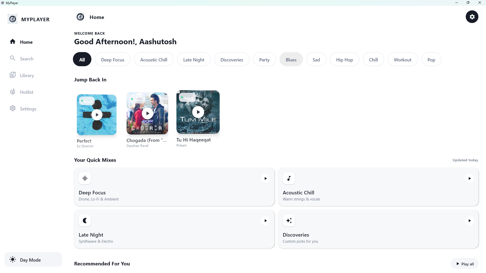
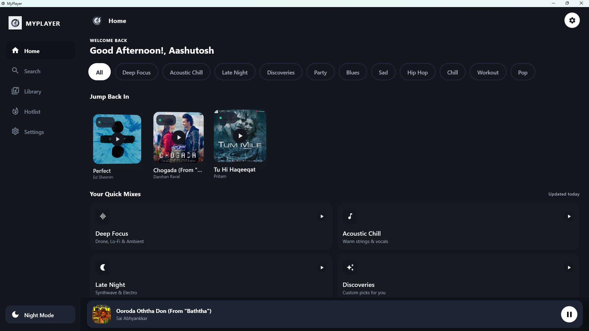
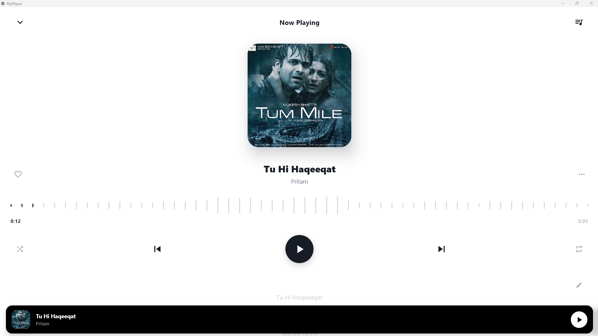
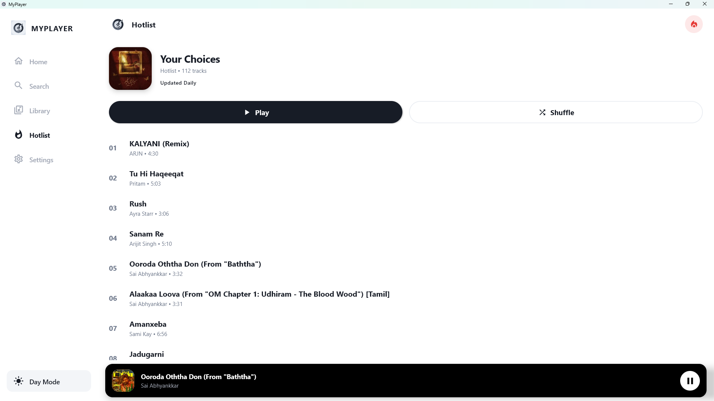
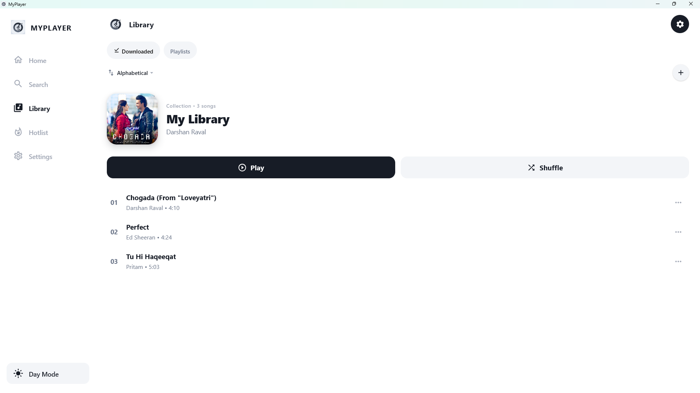

# 🎵 MyPlayer for Windows

<div align="center">


<p align="center">
  <b>A modern, high-performance Windows desktop music player built with Compose Multiplatform. Features a hardware-accelerated PCM audio engine, online streaming, synchronized lyrics, dark/light mode themes, and an innovative Dual Bud Mode that plays two different songs simultaneously through Left and Right earbuds.</b>
</p>

</div>

---

## 📸 Screenshots

<div align="center">

### 🏠 Home Screen


<br/><br/>

### 🌙 Dark Mode / Night Theme


<br/><br/>

### 🎵 Now Playing & Synchronized Lyrics


<br/><br/>

<table align="center" width="100%">
  <tr>
    <td align="center" width="50%">
      <b>🔥 Trending & Hotlist</b><br/>
      
    </td>
    <td align="center" width="50%">
      <b>📚 Library & Playlists</b><br/>
      
    </td>
  </tr>
</table>

</div>

---

## 🌟 Highlights & Features

- **🎧 Dual Bud Mode (Split Earbud Playback)**:
  - Play two separate songs simultaneously—one in your **Left earbud** and another in your **Right earbud**.
  - Independent play/pause, seek bars, and volume sliders for each channel.
  - **Instant Earbud Swap**: Reverse Left $\leftrightarrow$ Right channels on the fly without stopping playback.
  - Seamless pause/resume: retains exact audio frame timestamps without restarting from zero.
- **⚡ High-Fidelity Desktop Audio Engine**:
  - Direct hardware output via Windows `javax.sound.sampled.SourceDataLine` at 48,000 Hz, 16-bit signed little-endian PCM.
  - Built-in VLCJ (`libvlc`) background transcoding supporting MP3, FLAC, M4A, OGG, and streaming audio.
- **🖥️ Desktop-Optimized User Interface**:
  - Persistent vertical navigation bar for fluid switching between Home, Search, Hotlist, Library, and Dual Bud screens.
  - Clean Now Playing screen with focused album art, playback controls, and real-time synchronized lyrics.
- **🌓 Dark & Light Day/Night Themes**:
  - One-click toggle between sleek dark mode and crisp high-contrast light mode.
- **🌐 Hybrid Playback & Streaming**:
  - Stream music directly from online sources with fast search, autocomplete, and hotlists.
  - Play local audio files from your Windows storage.
- **📜 Synced Lyrics**:
  - Live synchronized karaoke-style lyrics with silky-smooth auto-scroll and manual line jumping.

---

## 🏗️ Architecture & Tech Stack

MyPlayer for Windows follows **Clean Architecture** and **MVVM** with strict Unidirectional Data Flow:

| Component | Technology |
| :--- | :--- |
| **Language** | [Kotlin](https://kotlinlang.org/) (Coroutines, StateFlow, Flow) |
| **UI Framework** | [Compose Multiplatform for Desktop](https://www.jetbrains.com/lp/compose-multiplatform/) (Material 3) |
| **Audio Core** | JavaSound API (`SourceDataLine`), VLCJ (`libvlc`), and AndroidX Media3 compatibility bridge |
| **Networking** | [OkHttp3](https://square.github.io/okhttp/) & [Retrofit](https://square.github.io/retrofit/) |
| **Image Loading** | [Coil 3](https://coil-kt.github.io/coil/) (Desktop JVM target with memory & disk caching) |
| **Packaging** | Compose Desktop Gradle Plugin (Standalone distributables & MSI installers) |

---

## 📁 Repository Structure

```text
MyPlayer_Windows/
├── app/
│   ├── src/
│   │   ├── main/
│   │   │   ├── java/
│   │   │   │   ├── android/media/   # JavaSound SourceDataLine AudioTrack hardware sink
│   │   │   │   ├── androidx/        # Desktop Media3 & Room runtime shims
│   │   │   │   └── com/example/myplayer/
│   │   │   │       ├── data/        # Repositories, YouTube Music & Lyrics APIs
│   │   │   │       ├── dualbud/     # Split-earbud mixer, FIFO buffers & audio routing
│   │   │   │       ├── playback/    # Audio playback controllers & resolvers
│   │   │   │       └── ui/          # Compose Desktop screens, theme & navigation
│   │   │   └── resources/           # App icons, fonts, and assets
│   │   └── test/                    # Split-channel playback unit tests (20 specs)
│   └── build.gradle.kts
├── docs/
│   └── screenshots/                 # High-resolution desktop screenshots
├── gradle/                          # Gradle wrapper
└── README.md
```

---

## 🚀 Getting Started

### Prerequisites

- **Windows 10 / 11** (64-bit)
- **JDK 17** or **JDK 21**
- *(Optional)* [VLC Media Player 64-bit](https://www.videolan.org/vlc/) installed at `C:\Program Files\VideoLAN\VLC` for extended codec transcode support.

### Clone & Run

1. **Clone the repository**:
   ```bash
   git clone https://github.com/Aashutosh2021/MyPlayer_Windows.git
   cd MyPlayer_Windows
   ```

2. **Run in development mode**:
   ```bash
   .\gradlew.bat :app:run
   ```

3. **Run unit tests**:
   ```bash
   .\gradlew.bat test
   ```

---

## 📦 Building Distributables & Installers

- **Generate Standalone Portable App**:
  ```bash
  .\gradlew.bat :app:createDistributable
  ```
  The packaged application will be generated at:
  `app\build\compose\binaries\main\app\MyPlayer\MyPlayer.exe`

- **Build Windows MSI Installer**:
  *(Requires [WiX Toolset](https://wixtoolset.org/))*:
  ```bash
  .\gradlew.bat :app:packageMsi
  ```
  The installer `.msi` will be output to:
  `app\build\compose\binaries\main\msi\`

---

## 🤝 Contributing

Contributions are welcome! Feel free to open issues or submit pull requests:

1. Fork the project.
2. Create your feature branch (`git checkout -b feature/amazing-feature`).
3. Commit your changes (`git commit -m 'Add amazing feature'`).
4. Ensure all tests pass (`.\gradlew.bat test`).
5. Push to the branch (`git push origin feature/amazing-feature`).
6. Open a Pull Request.

---

## 📄 License

This project is licensed under the [MIT License](LICENSE).
